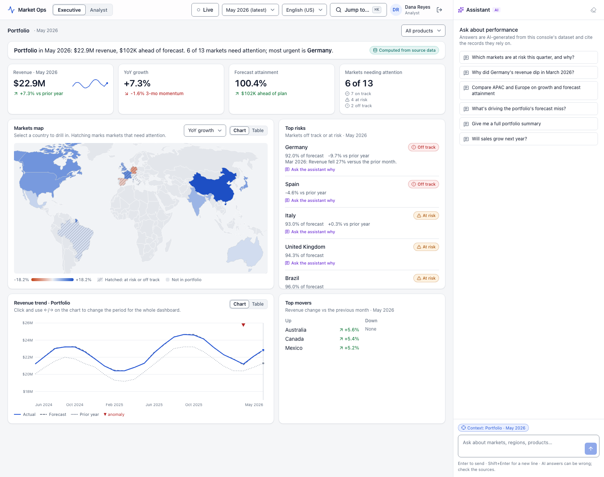
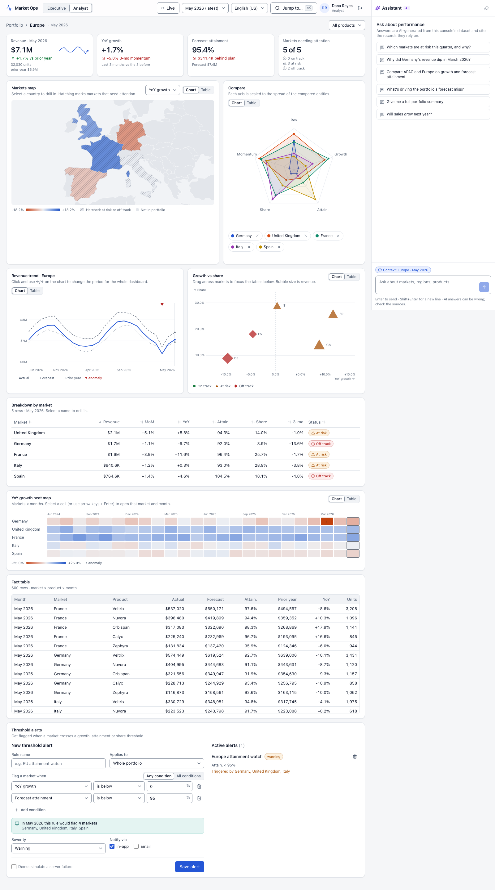
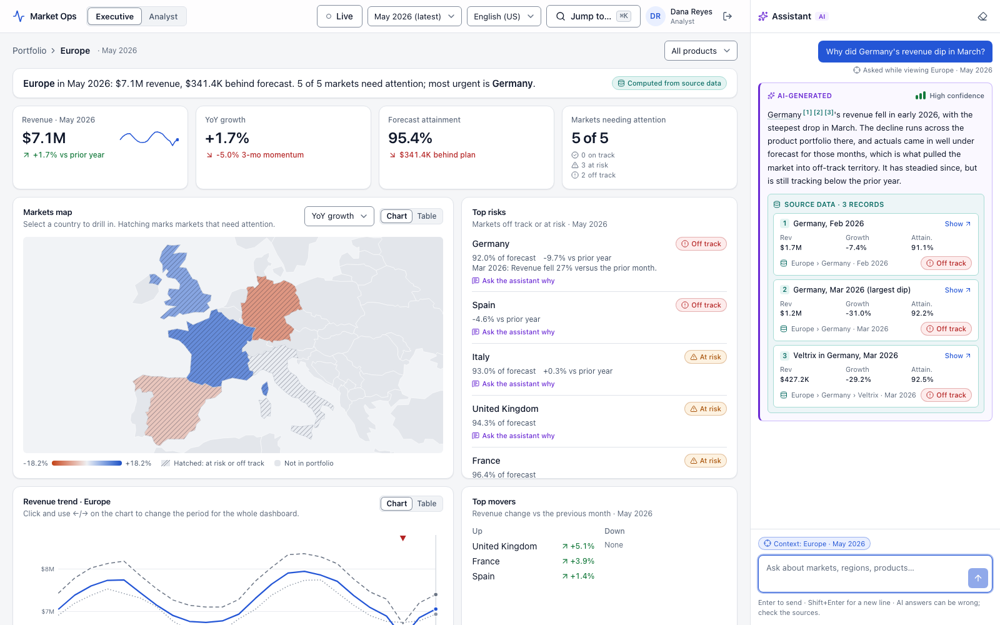
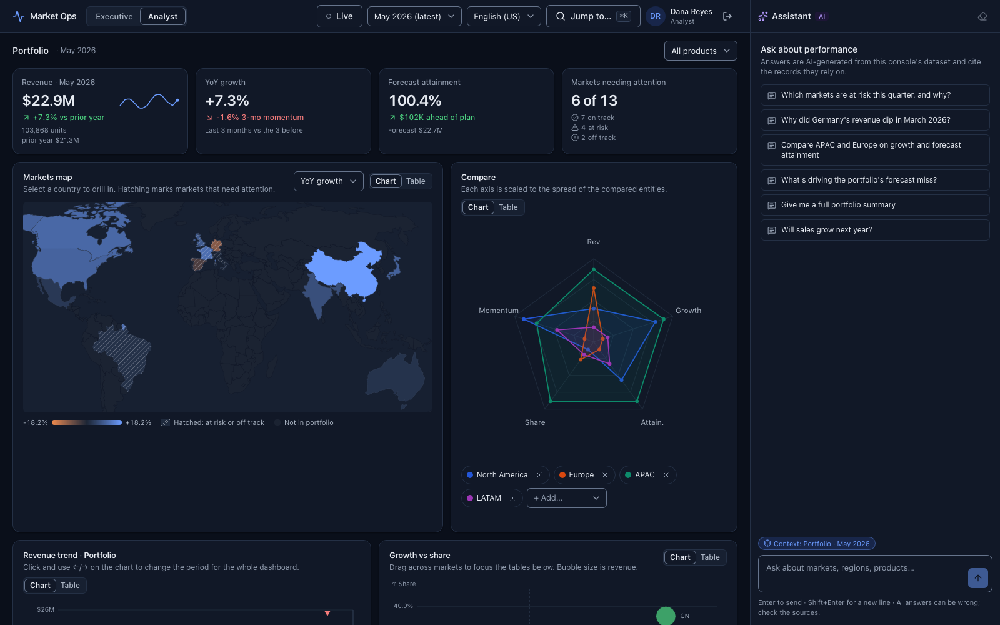
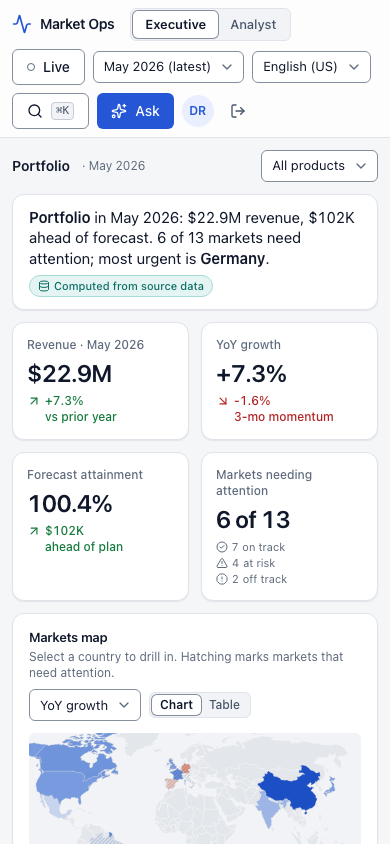
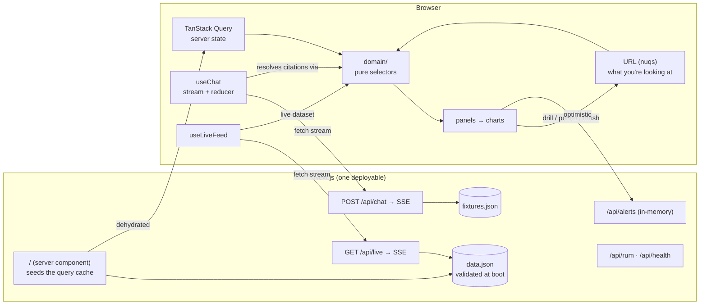

# Market Operations Console

**Live demo:** [market-ops-console.onrender.com](https://market-ops-console.onrender.com)

It's hosted on Render's free plan. If it hasn't been opened in a while, give it a minute to start.

Market Operations Console is a demo dashboard for a commercial operations team. It combines a portfolio overview, detailed market and product views, and a streaming assistant.

The assistant uses scripted responses from `fixtures.json`, streamed over SSE. The source-data cards under each answer are calculated from `data.json` with the same code as the dashboard.

Start with the executive view for a summary, or switch to the analyst view for the detailed charts, the fact table and alert rules.



| Analyst view (Europe)                    | Assistant with cited evidence                    | Dark mode                              | Mobile                           |
| ---------------------------------------- | ------------------------------------------------ | -------------------------------------- | -------------------------------- |
|  |  |  |  |

## Quick start

You need Node.js 22 or newer (`.nvmrc` pins 22) and npm 10 or newer.

```bash
npm ci
npm run dev
```

Open http://localhost:3000. The sign-in page offers two demo users: **Dana Reyes (analyst)** can manage alert rules, **Sam Okafor (viewer)** sees them read-only.

No `.env` file is needed; every setting has a default. To change one, copy `.env.example` to `.env.local` and edit `CHAT_TOKEN_DELAY_MS` (35), `ALERTS_LATENCY_MS` (600) or `LIVE_INTERVAL_MS` (3000).

### With Docker

Docker Engine 23+ (or Docker Desktop 4.17+) with Compose v2. Node isn't needed for this.

```bash
docker compose up --build        # dev server on :3000, Storybook on :6006
docker compose up --build app    # production image on :3000
```

Storybook only listens on localhost, because its dev server can write files in the project. After changing `package.json`, run `docker compose up --build --renew-anon-volumes dev`: `node_modules` lives inside the container.

### Things to try

1. Click Germany on the map.
2. Press ←/→ on the revenue chart to change the month, then press Back a few times. The URL replays the path.
3. Ask _"Why did Germany's revenue dip in March?"_ and press **Show** on a source.
4. Ask _"Will sales grow next year?"_. The assistant declines, because the data has no forecast that far.
5. Ask _"Give me a full portfolio summary"_ and press Stop halfway.
6. In the analyst view, drag across the scatter to narrow the tables.
7. Turn on **Live**. The current month updates every few seconds while the selection stays.

To see a failed save, create an alert rule with _simulate a server failure_ ticked: the rule appears, then rolls back with an error. Asking _"force error"_ shows the assistant's error state.

## Current limitations

The assistant uses the provided fixtures, as the assignment asks, and sign-in is a demo stub for the analyst and viewer roles. Beyond that:

- The session cookie holds a plain user id and isn't signed, so the stub isn't suitable for production.
- Alert rules are kept in memory and are lost on restart.
- No Content Security Policy and no rate limiting on `/api/rum`.
- Only numbers and dates are localised; UI text is English.
- No testing with VoiceOver or NVDA yet.

---

## Architecture



```
src/
  contracts/   zod schemas, the only types shared by client and server
  domain/      pure functions: KPIs, status rule, hierarchy, citations, alert checks
  server/      server-only code: data loader, chat fixtures, SSE, alert store, auth
  lib/         plain helpers: formatting, SSE parser, colours, http, monitoring
  styles/      design tokens
  components/  ui/ primitives and charts/ building blocks
  hooks/       reusable interaction hooks: keyboard grid, brush, period scrubber, sorting
  features/    dashboard/, assistant/, alerts/, live/, command-palette/, locale/, shell/
  app/         pages and thin API routes
```

Imports only go down. `domain/` doesn't know React exists, charts only take props, and panels connect hooks to charts. The KPI maths is tested on the real data without rendering anything, and the Storybook stories call the same domain functions instead of using mocks.

### Where state lives

For each piece of state I asked who owns it and whether it should travel with a shared link.

- **The dataset** is server state. The page renders on the server for the requested URL and seeds the TanStack Query cache, so the first HTML includes the dashboard for that URL.
- **Alert rules** are server state that can be slow or fail. They use `useMutation` with an optimistic insert or delete and a rollback on error.
- **What you're looking at** (drill path, period, view, map metric, radar comparison, scatter selection, live on/off) is in the URL via `nuqs` typed parsers. Drill and period changes add history entries, so Back walks the path; brush and metric changes replace the entry. Unknown ids or periods from an old link are repaired instead of reaching a chart.
- **The conversation** is a reducer in a provider, so closing the mobile drawer keeps it.
- **Number and date format** is a cookie, not a URL parameter. A colleague opening my link sees their own format, and the server reads the cookie, so the first HTML is already formatted.
- **Hover, open panels and chart/table toggles** are component state.

All panels read `useDashboardState()` and write through `drillTo`, `setPeriod` or `setFocus`. That's what links the views: a map click drills in, the trend chart sets the period for every panel, the scatter brush filters the tables, and an assistant citation opens the market and month it cites.

### Live mode

The latest month is treated as in progress. With **Live** on, `GET /api/live` streams its figures every 3 seconds over SSE.

- Data only flows from server to client, so SSE was enough. It's plain HTTP, sends cookies and runs in a normal route handler. WebSockets would make sense if the client had to stream back.
- Each update is a full snapshot computed from the current time, so a lost update or a reconnect can't make numbers drift.
- I kept live snapshots in React state after running into a hydration issue with the query cache (described under [How I used AI](#how-i-used-ai)).
- Each applied update increments a `revision`. Charts animate only when it changes, so drilling and switching periods are instant. Reduced motion turns the animation off.
- Switching live off shows the published dataset again.

## Calculations

For the latest month, market KPIs come from the dataset's `kpis` block, which the data marks as canonical. Earlier months, regions and product filters are derived from the fact table.

The status rule (on track, at risk, off track) isn't documented, so I inferred it from the data. A test checks that it reproduces the canonical status of all 13 markets.

Market share only exists as a snapshot for the latest month. Under a product filter it shows "—", and in earlier months the share columns, map and radar label the snapshot month.

## Decisions

**Next.js App Router.** I wanted the first render on the server and the mock API in the same deployable. I considered TanStack Start for its typed search params; `nuqs` gives typed URL state on Next. Next also has a standalone build output, which keeps the Docker image to one Node process with no extra server, and its route handlers serve the SSE streams directly.

**State tools.** The dataset is already in the page when it loads, so TanStack Query isn't there to fetch it. It gives server data one cache that the server can seed, and `useMutation` covers the optimistic save and rollback for alert rules.

The conversation is a reducer. An answer changes with each stream event (`token`, `done` with its sources and confidence, `error`) and when the user presses Stop, and the reducer keeps those transitions in one tested function. It lives in a provider so closing the mobile drawer doesn't lose it.

The rest of the UI state (hover, open panels, chart/table toggles) is local to components. Nothing else is shared, so there's no global store.

**Tailwind v4 with my own design tokens.** Components use semantic classes like `bg-surface`, `border-ai` and `text-fact`. Dark mode is a second set of token values, and the chart colour scales use `color-mix()` over the same tokens. I wrote the primitives myself to control their ARIA; the Select uses Radix, because a keyboard-accessible listbox is a lot of work to get right.

**Streaming over `fetch`.** `EventSource` can't send a POST body, so the chat uses `fetch` with a small SSE parser. Each event is validated against the contract, tokens are rendered at most once per animation frame, and Stop cancels the browser request and stops the server stream (`req.signal`). A stream that ends without its final `done` event is shown as interrupted.

**Making AI output trustworthy.** Metrics in the source-data cards are calculated from `data.json`.

- The answer sits in a violet frame labelled "AI-generated". The teal "Source data" block below it uses the same KPI code as the dashboard.
- Each citation is resolved against the dataset. A market or period that doesn't exist is marked **Unverified**.
- Confidence appears after the answer completes, as bars and a word.
- Low confidence, a refusal, an error, a stopped answer and an answer without sources each have their own message, so a refusal doesn't look like an answer.
- The summary sentence at the top of the dashboard is computed and labelled "Computed from source data".
- Model text is rendered as text nodes; there's no markdown or HTML path.

**Charts.** I used d3 for scales and geometry and rendered the charts with React. The main reason was keyboard interaction: countries need to be focusable, the heat map uses arrow keys, the scatter has a brush and the revenue chart behaves like a slider. This also means the SVG and interaction code is maintained in the project.

**Forms.** The alert form has a dynamic list of conditions, a channel choice and recipients that are required only when email is on. react-hook-form handles the field array and re-renders only the fields that change, and the zod schema from `contracts/` is the same one the server uses, so both sides reject the same input. While you edit, a preview lists the markets the rule would flag right now. Picking a threshold blind is hard, so I think that preview is the most useful part of the form.

**Sign-in and roles.** I added a sign-in stub to demonstrate the analyst and viewer roles; the brief allows mock authentication, so there's no identity provider. Without a session, the page redirects to `/signin?returnTo=…`; `returnTo` only accepts paths on this site. Permissions live in `domain/permissions.ts`. The UI uses them to show alert rules read-only for a viewer, and the chat, live and alerts routes check the session and permission themselves. Only `/api/health` and `/api/rum` are open. I didn't put the check in `proxy.ts`, since Next's docs say Proxy isn't meant for authorization.

**One app, no separate services.** The brief asks not to build a backend. A real model would sit behind the same `/api/chat` contract.

---

## Accessibility

The target is WCAG 2.1 AA. Automated checks run axe with best-practice rules on both views in both themes and on each assistant state; all 53 Storybook stories also pass axe.

- **Table alternatives.** Each chart has a table view with the same data.
- **Keyboard.** Map countries, scatter points and radar series are focusable and have text descriptions. The heat map is an arrow-key grid, and the revenue chart is a slider over months.
- **Colour.** Status is shown with an icon, a shape and a word. At-risk countries are hatched, forecast and prior year are dashed and dotted, and deltas have arrows.
- **Contrast.** Text is at least 4.5:1; control borders, chart lines and the focus ring are at least 3:1, in both themes.
- **Screen readers.** The assistant announces when an answer starts and when it ends, not each token. Drill and period changes are announced and update the page title. Live updates aren't announced.
- **Mobile drawer.** `role="dialog"`, the page behind is `inert`, Escape closes it and focus returns to the opener.
- **Layout.** Panels stack on phones, sit two-up from `lg`, and the assistant docks as a column from `xl`. Charts measure their container and draw in real pixels, so axis text stays around 10px. Pages reflow at 320px, and small controls get a 40px hit area on touch screens. Browser checks cover layout shifts on load, on chart/table switches and during live updates.
- **Motion.** Live mode is off by default and acts as the pause control for auto-updating content (WCAG 2.2.2). Reduced motion and forced colours are respected.

Keyboard testing caught a problem that axe had missed: drilling into a market removed the focused button, leaving focus at the top of the page. The drill action now moves focus to the new content. The same pass found that every answer reused the same source ids, so `[1]` in the third answer jumped to the first answer's source.

## Testing

```bash
npx playwright install chromium   # once, before the first E2E run
npm run check                     # lint, type check, unit and component tests
npm run test:e2e                  # production build + Playwright
npm run storybook                 # component workshop on http://localhost:6006
```

`npm run check` runs Vitest (69 tests and a render of each of the 53 stories). The tests cover the KPI calculations and status rule on the real data, drill paths and URL repair, citations, alert evaluation, live updates, stream parsing (split chunks, error events, a missing `done` event, malformed events, abort), formatting across locales and the answer card's trust states.

`npm run test:e2e` builds the app and runs 41 Playwright tests against it. They cover drilling and Back, shared links in the server HTML, linked views, ⌘K, cited and declined answers, Stop, alert saves with rollback, live updates, sign-in and roles, axe checks, keyboard-only use, the JS budget, and layout at 320, 390, 1024 and 1440px.

`npm run smoke` checks the production Docker image: it starts a container from `market-ops-console:local` and requests the health endpoint, the sign-in redirect, the page and the chat stream. It doesn't build the image, so run `npm run docker:prod` first, stop it, and then run the smoke test; it uses port 3000 by default, or another port with `npm run smoke -- 3001`.

I skipped unit tests for things an E2E test already covers and for simple mapping code. Tests sit in `__tests__/` folders next to the code.

Storybook holds the building blocks: UI primitives, the charts on the real dataset, the KPI tile and the answer card in each stream state. Each component has a `Default` story, and every other story changes one prop and is named after it.

## Getting it to production

**Performance.** The page is rendered per request for its URL. The analyst view, the command palette and the map geometry are lazy-loaded, the 1,560-row fact table is virtualised, aggregations are memoised per scope, and during streaming only the active answer re-renders.

CI enforces first-load JavaScript budgets. [e2e/performance.spec.ts](e2e/performance.spec.ts) measures the compressed JavaScript the browser downloads before the dashboard is usable: 314 KB for the executive view and 354 KB for the analyst view, against limits of 330 and 375 KB. React and Next are about 150 KB of that. There are no budgets for LCP, INP or CLS yet: those need field data from real users.

**Caching.**

- `data.json` is imported into the server build and validated once at startup, so a new dataset means a new deploy.
- The page reads the session cookie, so it's rendered per request and the HTML isn't cached. Scripts and styles under `/_next/static` have content hashes, and Next serves them with long-lived immutable cache headers.
- On the client the dataset is seeded into the query cache with `staleTime` and `gcTime` set to `Infinity` ([queries.ts](src/features/dataset/queries.ts)): it never changes during a visit, so it's never refetched. A reload picks up a new deploy. Alert rules use a 60-second `staleTime` and refresh after each save or delete.
- API routes are dynamic. SSE responses send `Cache-Control: no-cache, no-transform` and `X-Accel-Buffering: no` ([sse.ts](src/server/sse.ts)), so proxies don't buffer or compress the stream.

**Observability.** [WebVitals.tsx](src/features/observability/WebVitals.tsx) sends Web Vitals, and the assistant sends its answer time, to [/api/rum](src/app/api/rum/route.ts). The route validates the event and logs it; it's a stand-in for a vendor collector, so there is no RUM backend or release gate on those metrics yet. Errors go through `reportError` in [observability.ts](src/lib/observability.ts), which is where Sentry would plug in. Each panel has its own [error boundary](src/components/ui/ErrorBoundary.tsx).

**Hardening.** The env, the dataset, request bodies, stream events and URL params are validated with the zod schemas in [src/contracts](src/contracts). Security headers are set in [next.config.ts](next.config.ts), alert payloads are re-validated on the server, and `/api/rum` reads at most 4 KB of a request body.

**Build.** Next standalone output in a multi-stage [Dockerfile](Dockerfile) that runs as non-root, with a healthcheck on `/api/health`. The production service in [docker-compose.yml](docker-compose.yml) also uses a read-only filesystem.

**CI.** [ci.yml](.github/workflows/ci.yml) checks formatting, lint, types and unit/component tests, then builds Storybook. Playwright and the Docker smoke test run next, in parallel. The final **CI passed** job gives branch protection one check to require.

**Deployment.** I chose Render Free to run the app as a single Docker container. [render.yaml](render.yaml) configures automatic deploys from `main` after CI passes and a healthcheck on `/api/health`.

On the [free plan](https://render.com/docs/free), the service sleeps after 15 minutes without incoming traffic. The next visit can take about a minute to wake it. Alert rules are lost when the process restarts, including after a deploy or sleep.

## Standards

**Followed:** strict TypeScript with no `any`, one place for each calculation (KPIs, URL state, table columns), files under about 150 lines, a pure domain layer, shared contracts, and conventions written down in `CLAUDE.md`.

**Skipped:** UI translations, real authentication, persistent alerts, commit hooks.

## How I used AI

I used Claude Code for most of the implementation. I set the project structure and rules, reviewed the changes, and checked the app in the browser.

The rules live in `CLAUDE.md`: the layering, one source per fact, AI colours vs data colours, how tests and stories are written, file size, and no `dangerouslySetInnerHTML`. When a problem came up twice, it became a rule there, so each session starts from the same conventions.

Most features went through the same steps: contract, domain function with a test, hook, component, then a look in the browser using Playwright screenshots in light, dark and mobile. The screenshots caught things the tests didn't, such as the Europe map being framed around French Guiana and a legend glyph drawn twice.

I also ran separate review passes over the code. One found that the assistant context changed on every streamed token and re-rendered the header about 60 times a second; I split it into stable actions and changing state.

To check that tests protect something, I broke the code on purpose and made sure a test failed.

One problem the tests didn't catch at first: my first live mode wrote updates into the query cache. If an update arrived before a lazily loaded view had hydrated, React discarded the server HTML; it happened in 20 of 30 production loads. I moved live data into React state, and a Playwright test now checks that the server HTML survives with live on at load.

**Do:** give the model a structure to fill in, and check its numbers and copy against the data. **Don't:** let it pick a library without stating the trade-off, or render model output as HTML.

## Next steps

1. **Protect `main` and check deployments.** Require **CI passed** before merging. After that I'd add preview URLs for pull requests and smoke tests against each deployment.
2. **Real sign-in and persistent alerts.** OIDC with a signed session, and a database for alert rules with an idempotency key, so a retried save can't create a duplicate.
3. **Error tracking.** Connect Sentry at `reportError`, upload source maps and tag errors with the release, so a regression after a deploy is visible quickly.
4. **Connect a real model and add a repeatable evaluation set.** This is the next product step rather than part of this assignment. The fixtures exercise the UI, but they can't show how reliable generated answers will be. A set of questions with expected sources would check that citations resolve and numbers match `data.json`, run on every prompt or model change.
5. **Server-side aggregation if the data grows.** The whole dataset is sent to the browser, which is fine for 1,560 rows. `domain/` has no React dependency, so it can move to the server when needed.
